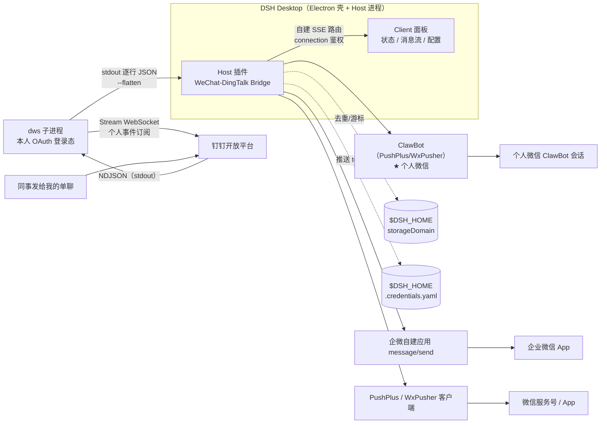
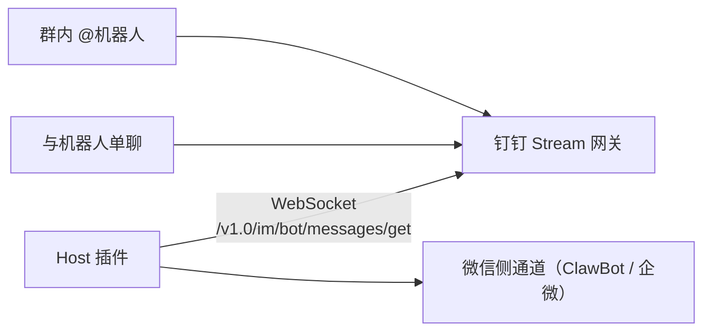
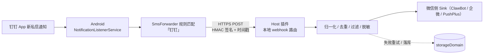
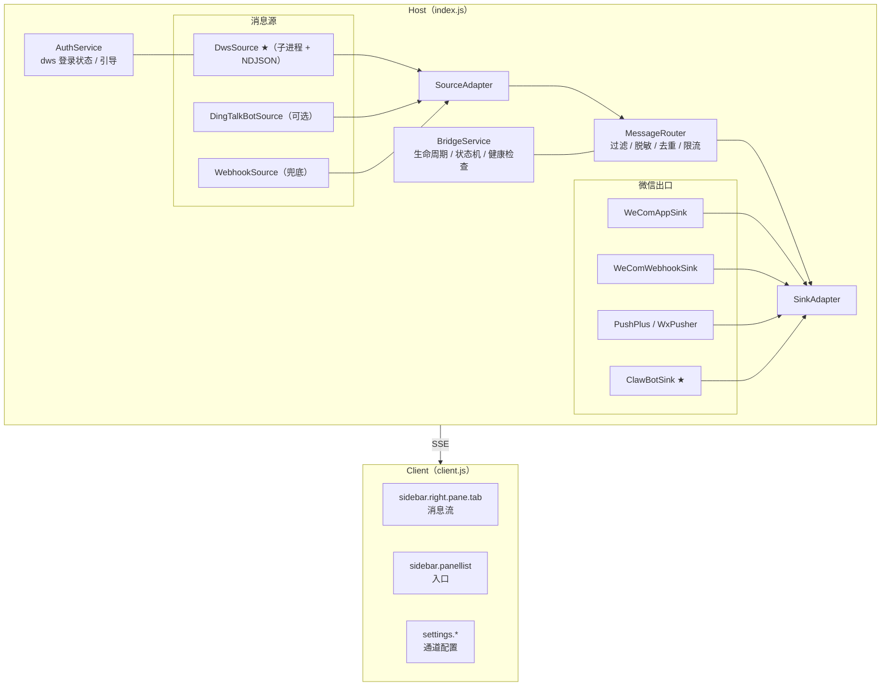
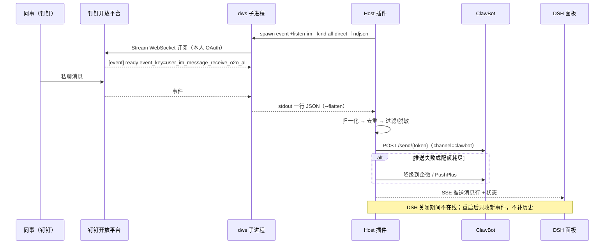

# 架构与数据流（Mermaid）

> 配套文档：[可行性报告](../feasibility-report.md)。GitHub / 支持 Mermaid 的 Markdown 阅读器可直接渲染。

## 1. 方案 A（主）：dws 个人事件订阅 → ClawBot

**前提**：组织管理员开通 CLI Access Management；`dws auth login` 完成。**边界**：只推订阅启动后的新事件，不补历史。

## 2. 方案 B（可选）：官方 Stream 机器人桥

**边界**：只能收「发给机器人」的消息，收不到同事私聊；适合双向问答与群通知。

## 3. 方案 C（兜底）：端侧通知转发

**边界**：单向下行；通知可能被系统折叠；需常开手机；关闭通知/免打扰会漏消息。仅在拿不到 CLI 权限时使用。

## 4. 插件组件划分

## 5. 正常路径时序（方案 A）

